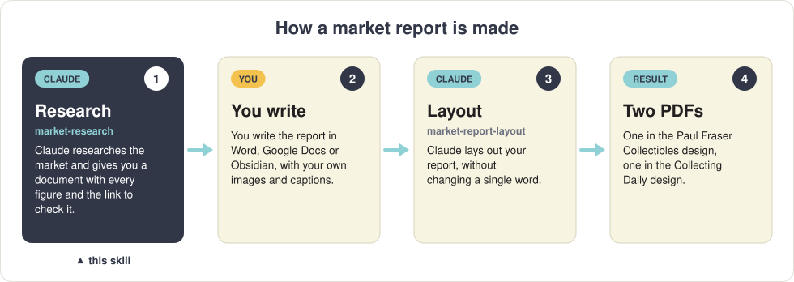
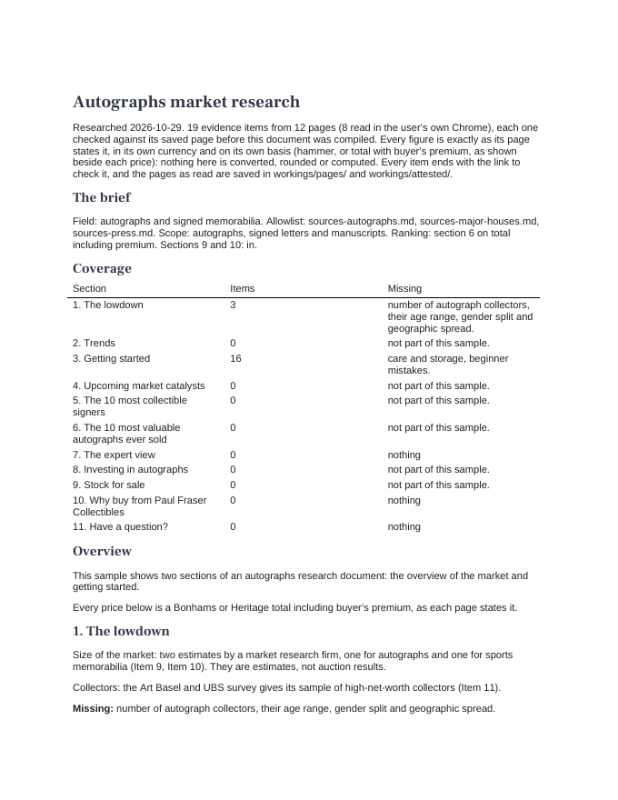
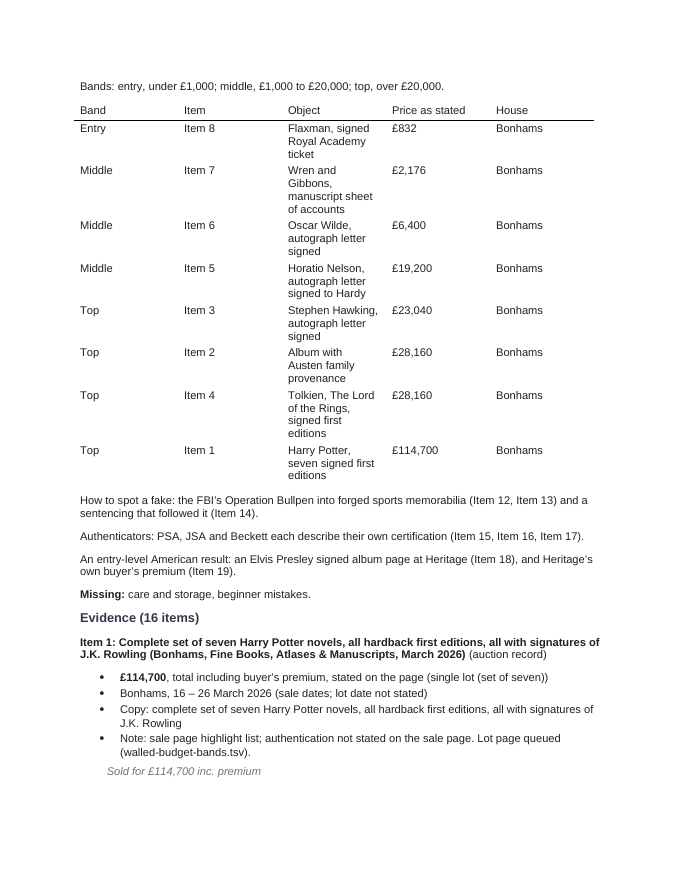
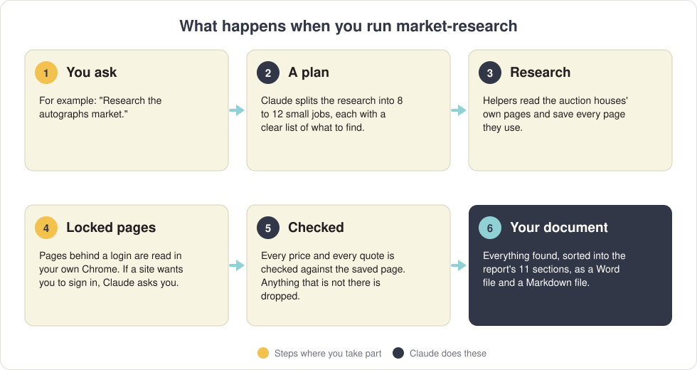
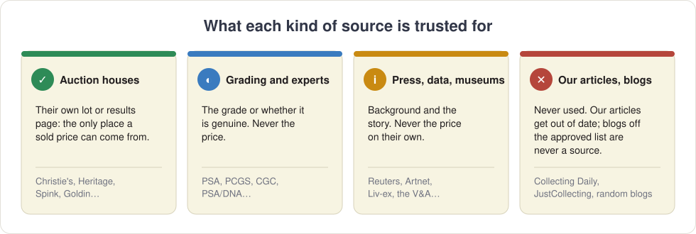
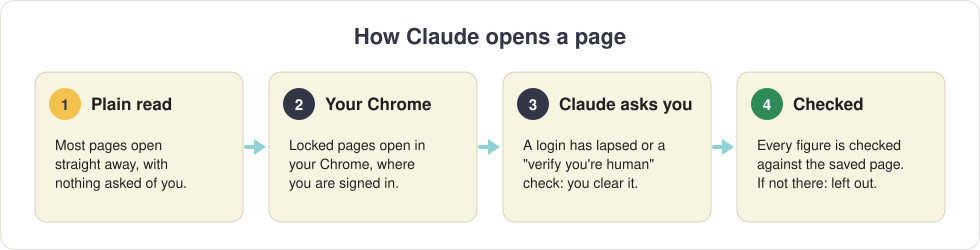

# Market research

**Claude researches a collecting market for you, and hands you everything it found, neatly sorted, so you can write the market report yourself.**

<p align="center"></p>

This skill is step 1. It does the research and stops. It never writes the report, never chooses images and never makes a PDF: you do the writing, and the [market-report-layout](https://github.com/CollectingDaily/claude-market-report-layout) skill turns your finished report into the two designed PDFs.

<p align="center">
  <a href="#what-you-get"><strong>What you get</strong></a> ·
  <a href="#how-the-research-works"><strong>How the research works</strong></a> ·
  <a href="#the-sources"><strong>The sources</strong></a> ·
  <a href="#accounts-you-need"><strong>Accounts you need</strong></a> ·
  <a href="#installing-it"><strong>Install</strong></a> ·
  <a href="#using-it"><strong>Use</strong></a> ·
  <a href="#questions"><strong>Questions</strong></a>
</p>

---

## What you get

One document, laid out on the eleven sections of a market report, with everything the research found under the section it belongs to. You get it twice: as a **Word file** (opens in Word, LibreOffice or Google Docs) and as a **Markdown file** (opens in Obsidian).

<p align="center">
  
  &nbsp;
  
</p>
<p align="center"><em>A real example: two pages of an autographs research document.</em></p>

**Page 1** tells you what was researched and gives a **coverage table**: for each section of the report, how many pieces of evidence were found and what is still missing.

**Each section** then explains what it needs and which evidence covers it, followed by the evidence itself. Every piece of evidence shows:

- **the price**, exactly as the auction house printed it, and whether it includes the buyer's premium;
- **the auction house and the date**;
- **the sentence copied from the page**, so you can see the proof;
- **a link to check it yourself.** A few auction houses only show prices to people who are signed in: those links say so.

At the end you'll find the **heat signals** (is the market busy or quiet?), any **conflicts** where two sources disagree (both are shown: you decide), PFC's **live stock** for the field, and a list of anything that couldn't be found.

> **Nothing is made up, converted or rounded.** If a figure isn't on the page it links to, it isn't in the document. Prices stay in the currency they were sold in: converting them is part of writing the report.

---

## What happens when you run it

<p align="center"></p>

You only take part twice: when you ask, and if a website wants you to sign in. Everything else runs on its own. A full run takes a while and uses a good part of your Claude allowance, so start it when you don't need Claude for much else.

---

## How the research works

The research follows one rule: **a price is only true if the auction house that sold it says so, on its own page.** Everything else follows from that.

<p align="center"></p>

**1. A plan.** Claude splits the market into 8 to 12 small jobs (the top ten sales, prices by budget, the market's direction, and so on), each with a list of what to find and how much is enough.

**2. Helpers research at the same time.** Each job goes to its own helper, which looks only at the sites on the approved list for your subject (see [The sources](#the-sources)) and saves every page it uses.

**3. Locked pages open in your Chrome.** Some sites only show prices to people who are signed in. Claude opens those in *your* Chrome, where you're already signed in, and saves the page:

<p align="center"></p>

**4. Every figure is checked.** A checking program compares every price and every quote with the saved page, word for word. If it isn't on the page, it comes out.

**5. A second pair of eyes.** A separate reviewer, which did none of the research, reads the finished document against the pages before you get it.

**6. Nothing is decided for you.** When two sources disagree, you get both. When something can't be found, the document says so rather than guess.

---

## The sources

### Used for every subject

| | |
| --- | --- |
| 🏛️ **The major auction houses** | Christie's, Sotheby's, Bonhams, Phillips, Heritage Auctions and Julien's. |
| 🛍️ **Paul Fraser Collectibles** | Our live stock for the subject. Shown as stock for sale, never as an auction result. |
| 🔎 **Auction search sites** | Invaluable and Barnebys, used only to *find* a sale. The price is then read on the house's own page. |
| 📰 **The press** | About 35 major titles (Reuters, the BBC, the FT, the New York Times, The Times, Le Monde, El País and others), for background only. A newspaper is never the only proof of a price. |

### By subject

On top of those, each subject has its own approved list. These are the main ones:

| Subject | Where sold prices come from | Also used (never for a price) |
| --- | --- | --- |
| 🎨 **Art** | Artcurial, Dorotheum, Ketterer Kunst, Lempertz, Bukowskis, Woolley & Wallis, Lyon & Turnbull, Swann, Doyle, Hindman | Artnet, Artprice, The Art Newspaper, museums such as Tate and the Getty |
| ✍️ **Autographs and historical documents** | RR Auction, Nate D. Sanders, Alexander Historical, Swann, Freeman's | PSA/DNA, JSA, Beckett, UACC for authenticity |
| 🪙 **Coins** | Stack's Bowers, Heritage, Spink, Baldwin's, Noonans, GreatCollections, Morton & Eden, Künker, CNG | PCGS and NGC for grades; Coin World |
| 💥 **Comics** | ComicConnect, ComicLink, Metropolis, Hake's, Goldin | CGC, CBCS and Overstreet for grades; GoCollect |
| 🎬 **Film, TV and music** | Propstore, Premiere Props, Julien's, RR Auction, Omega, Tracks, Guernsey's | — |
| 📷 **Photography** | Swann, Forum Auctions, Leitz Photographica | — |
| 🗳️ **Political** | Hake's, RR Auction, Alexander Historical, Swann, Weiss | — |
| 📚 **Rare books** | Swann, Forum Auctions, Dominic Winter, Hansons, Lyon & Turnbull | AbeBooks |
| 👑 **Royal** | Reeman Dansie, Historical & Collectable | — |
| 🚀 **Space and aviation** | RR Auction, Dominic Winter, C&T Auctioneers | collectSPACE |
| ⚾ **Sports** | Goldin, SCP, Lelands, Grey Flannel, Memory Lane, Robert Edward Auctions | Sports Collectors Digest |
| ✉️ **Stamps** | Stanley Gibbons, Spink, David Feldman, Siegel, Corinphila, Grosvenor, H.R. Harmer | Royal Philatelic Society and Philatelic Foundation for authenticity |
| 🧸 **Toys** | Hake's, Vectis, Morphy, Bertoia, Theriault's, LCG, Goldin | AFA, CAS and UKG for grades |
| 🃏 **Trading cards** | Goldin, PWCC, Robert Edward Auctions, Memory Lane, Love of the Game | PSA, Beckett, SGC, CGC for grades; Card Ladder |
| 🍷 **Wine and spirits** | Sotheby's, Christie's, Bonhams, Hart Davis Hart, Zachys, Acker, Whisky Auctioneer | Liv-ex, Wine-Searcher, Decanter |

The full lists, with notes on each site, are in [`references/sources/`](references/sources/).

> [!IMPORTANT]
> **Never used:**
>
> - **Our own articles** (Collecting Daily and JustCollecting). We want the most up-to-date information, and an article is only as current as the day it was published. Every figure is found again, fresh, at its source.
> - **Blogs that aren't on the approved list.** A random blog is never a source, and never the way to find one. Only blogs from the trusted names on the list count, such as those of the British Museum, the V&A or the Smithsonian, and even then for background only, never for a price.

---

## Accounts you need

Some auction houses hide sold prices until you sign in. **Sign in to these once in Google Chrome and stay signed in**: Claude reads the pages in your Chrome, so it sees the prices you would see. It never sees or types your password.

| Account | Cost | Needed for | Without it |
| --- | --- | --- | --- |
| **[Heritage Auctions](https://www.ha.com/)** | Free | ⭐ Every subject | Prices read "Sold For: Sign-in" |
| **[Sotheby's](https://www.sothebys.com/)** | Free | ⭐ Every subject | Prices read "Log in to view results" |
| **[Goldin](https://goldin.co/)** | Free | Trading cards, sports, comics, toys | Prices show "$0 Winning Bid" |
| **[Propstore](https://propstore.com/)** | Free | Film and TV | Sold prices are hidden |
| **[Vectis](https://www.vectis.co.uk/)** | Free | Toys | Sold prices are hidden |
| **[Antiques Trade Gazette](https://www.antiquestradegazette.com/)** | Subscription *(optional)* | Art and antiques news | Articles are locked |

⭐ = needed for every report. The others matter only for their subjects.

If a login has run out during a run, or a site shows a "verify you're human" check, Claude stops and tells you which site. Sign in or tick the box in Chrome, tell Claude it's done, and it carries on. Without an account the research still runs, but those prices will be missing from your document.

---

## What you need

| | |
| --- | --- |
| 💻 **A Mac** | The skill uses tools that come with macOS. |
| 🤖 **The Claude app**, with its **Code** tab | A paid Claude plan (Pro, Max, Team or Enterprise). Download it from [claude.com](https://code.claude.com/docs/en/desktop-quickstart). |
| 🌐 **Google Chrome** with the **Claude in Chrome** extension | Some auction houses only show prices to people who are signed in. Claude reads those pages in *your* Chrome, where you're already signed in. It never sees or types a password. See [Accounts you need](#accounts-you-need). |
| 📝 **pandoc** *(optional)* | Makes the Word copy of the document. Without it you get the Markdown file only. |

---

## Installing it

1. **Open the Claude app**, click the **Code** tab, choose **Local** and any folder (such as Documents).
2. **Paste this** into the message box and press **Return**:

   ```text
   Install the skill from https://github.com/CollectingDaily/claude-market-research into ~/.claude/skills/claude-market-research
   ```

3. **Click Allow** when Claude asks to download it.
4. **Quit the Claude app completely** (⌘ Q) and open it again. Type **/** in the message box and look for **market-research** in the list. If it's there, you're ready.

New to Claude, or setting up a Mac for the first time? The [Collecting Daily page](https://github.com/CollectingDaily) explains everything step by step, including how to update your skills.

The first time you use it, Claude sets up its research helpers and may ask you to start a new session. Do that, then ask again.

---

## Using it

1. **Open a folder** for your research in the Claude app (Code tab → Local → Select folder).
2. **Make sure Chrome is open**, with the Claude extension switched on.
3. **Ask:** */market-research Research the autographs market*
4. **Keep an eye out for questions.** If a site shows a sign-in page or a "verify you're human" check in your Chrome, Claude stops and asks you to deal with it. Do it in Chrome, tell Claude it's done, and it carries on.
5. **Open your document.** It's in a new folder called **Market research**, inside the folder you chose:

```
Market research/
    Autographs/
        Autographs market research.docx    ← open this in Word or Google Docs
        Autographs market research.md      ← or this one in Obsidian
        workings/                          ← Claude's notes and saved pages (you can ignore these)
```

Then write your report, with your own images and captions, and hand it to **market-report-layout** for the PDFs.

---

## Questions

**Can I trust the figures?**
Every price and quote was checked against the page it came from before the document was made, and a second, independent check reads the whole document again before you get it. Even so, the links are there so you can look for yourself, and you should for anything you lead with.

**Why does it say "not stated"?**
The page didn't say. The document never guesses: "house not stated" means the page gave no auction house.

**Two sources disagree. Which is right?**
The document shows both, with what kind of page each is (the auction house's own record, a magazine, the press). The auction house's own sale record is usually the one to trust, but it's your call.

**Some prices are in dollars, some in pounds.**
Each price is shown as it was sold. Convert them when you write, at the day's exchange rate.

---

<details>
<summary><strong>For the technically minded</strong></summary>

`SKILL.md` is the full procedure. The run is driven by `scripts/next_step.py`, which decides every step from the files on disk: research agents (one per task card, 8 to 12), captures of walled pages in the user's Chrome (`capture_server.py`), readers for the captures, the checkpoint, the log check (`merge_logs.py`, `check_log.py`, which runs `verify_sources.py` and `check_attested.py`), the compiler, which writes `analysis.md`, `compile_research.py`, which builds the document and refuses any price or percentage not in the evidence item it names, the reviewer and a fix pass. The agents are in `agents/` and are copied to `~/.claude/agents/` on the first run. The source lists for every field are in `references/sources/`. Needs Python 3 and curl; pandoc for the `.docx`, styled by `assets/research-reference.docx`.

</details>
